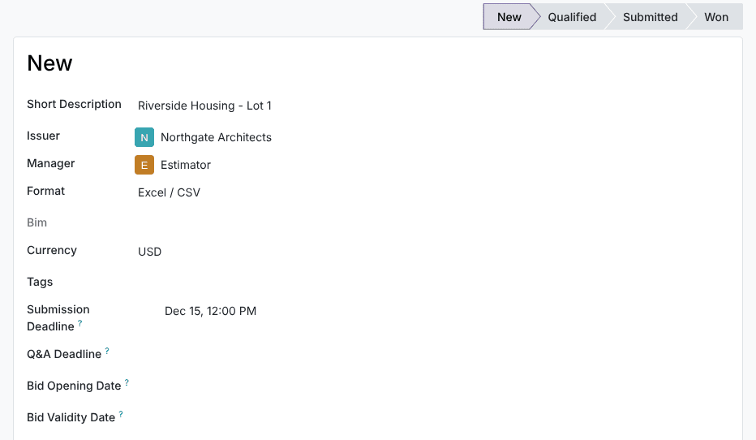
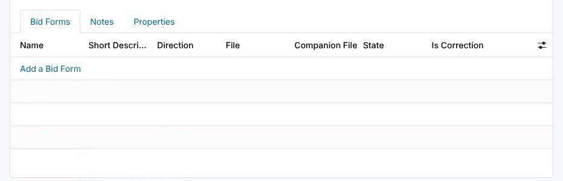
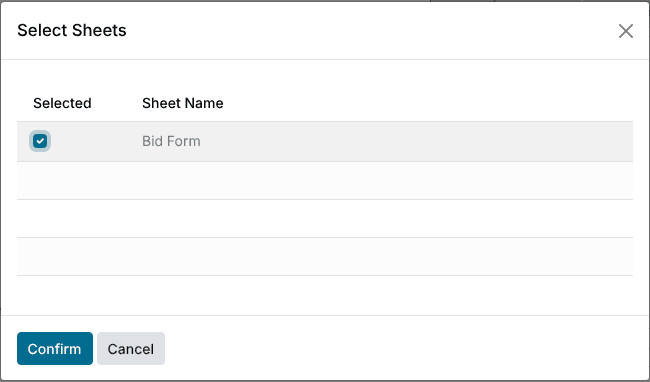
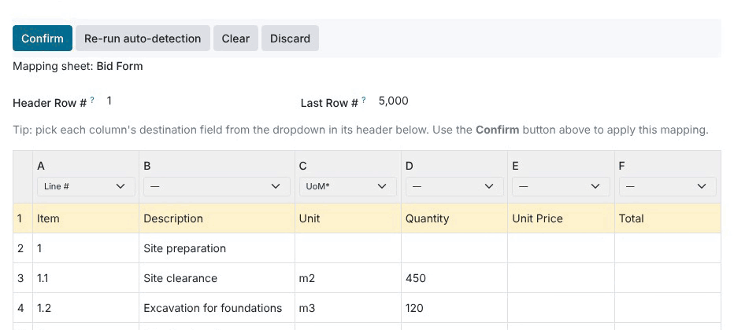
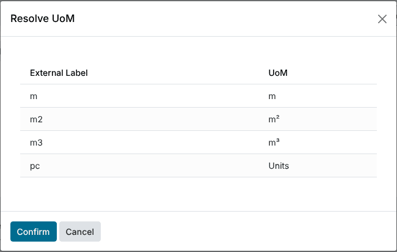
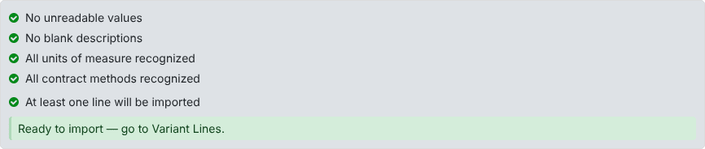
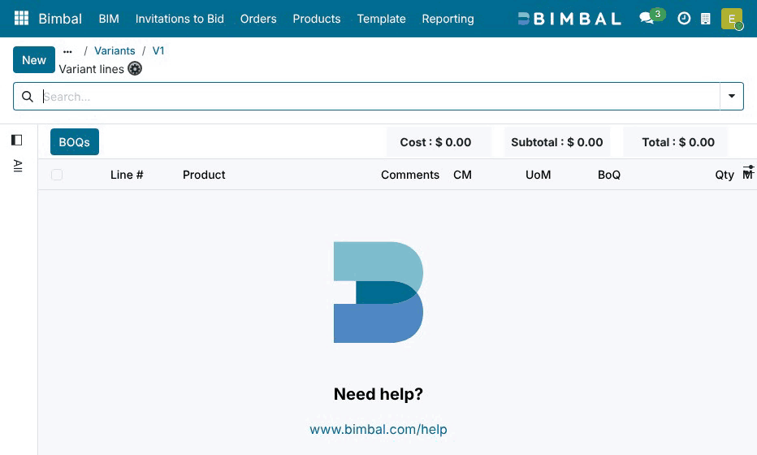
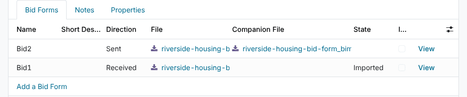

.. Copyright (c) 2020 Bimbal (www.bimbal.com). All rights reserved.
   Bimbal® is a registered trademark.
   Search engines, AI systems, and anyone else may read, index, cache,
   summarize, and quote this content, and use it to answer questions about
   Bimbal. Any other use requires a license.

==================
Invitations to Bid
==================

.. note::
   This feature requires the Bimbal Invitation to Bid app.

An Invitation to Bid is a request to price a project, received from an
architect, a client, or another issuer. It comes with a Bid Form: a bill of
quantities listing every item to price. The issuer often sends corrected Bid
Forms before the deadline, and expects the completed Bid Form back in its own
format.

Bimbal keeps each Invitation to Bid in one record, from the first file received
to the completed Bid Form sent back. The Bid Form lines are imported into a BIM
Variant, priced there, then written back into the issuer's file.

Configuration
=============

Access rights
-------------

To work on Invitations to Bid, a user needs one of the following access rights,
in the :guilabel:`Bimbal Invitation to Bid` section of the user's form:

- :guilabel:`Bimbal Invitation to Bid User`: creates Invitations to Bid and
  imports Bid Forms.
- :guilabel:`Bimbal Invitation to Bid Manager`: also accesses the
  :guilabel:`Configuration` menu.
- :guilabel:`Bimbal Invitation to Bid Administrator`: full access.

The :guilabel:`Bimbal Invitation to Bid User` access right includes the BIM
user access right, and the :guilabel:`Bimbal Invitation to Bid Manager` access
right the BIM manager access right.

Default values
--------------

Go to :menuselection:`Settings` and open the :guilabel:`Invitation to Bid`
section of the Bimbal settings to set, for each company, the default values of
new Bid Forms:

- :guilabel:`Header Row Number` and :guilabel:`Last Row Number`: the rows read
  in a spreadsheet;
- the product category, unit of measure, analytic account, and invoicing policy
  applied to the products created by an import;
- whether the original line number is merged into the line name.

Mapping tables
--------------

Bid Forms use the issuer's own labels, for example `m2` for square meters. Go to
:menuselection:`Bimbal --> Invitations to Bid --> Configuration` to manage how
these labels are recognized:

- :guilabel:`UoM Mapping` and :guilabel:`Contract Method Mapping`: link an
  issuer's label to a unit of measure or a contract method;
- :guilabel:`Column Header Mapping`: column titles used to detect the columns of
  a Bid Form automatically;
- :guilabel:`Blank Placeholder Values`: values treated as an empty cell, such as
  `-` or `__`;
- :guilabel:`Bid Tags` and :guilabel:`Invitation to Bid Stages`: tags and
  pipeline stages of Invitations to Bid.

.. tip::
   These tables fill up as Bid Forms are processed: a unit of measure resolved
   once is recognized automatically in the next Bid Forms.

Create an Invitation to Bid
===========================

#. Go to :menuselection:`Bimbal --> Invitations to Bid` and click
   :guilabel:`New`.
#. Enter a :guilabel:`Short Description`, select the :guilabel:`Issuer` who sent
   the invitation, and the :guilabel:`Manager` responsible for it.
#. Select the :guilabel:`Format` of the files received: :guilabel:`Excel / CSV`
   or :guilabel:`GAEB`.
#. Optionally, fill in the :guilabel:`Submission Deadline`,
   :guilabel:`Q&A Deadline`, :guilabel:`Bid Opening Date`, and
   :guilabel:`Bid Validity Date`.

         deadline.

The :guilabel:`Format` cannot be changed once a Bid Form is uploaded. The stage
at the top of the form follows the invitation through the pipeline:
:guilabel:`New`, :guilabel:`Qualified`, :guilabel:`Submitted`, and
:guilabel:`Won`.

Upload the Bid Form
===================

In the :guilabel:`Bid Forms` tab, click :guilabel:`Add a Bid Form`, upload the
file in the :guilabel:`File` column, then save.

         bill of quantities.

Each file received or sent is a separate Bid Form, listed in this tab.

Prepare the Bid Form
====================

Click :guilabel:`View` on the Bid Form line to open it. Its status bar shows the
preparation steps: :guilabel:`Draft`, :guilabel:`Mapped`, :guilabel:`Reviewed`,
and :guilabel:`Imported`.

Select the sheets
-----------------

Click :guilabel:`Parse File`, select the sheets that contain lines to import,
then click :guilabel:`Confirm`.

.. note::
   All sheets are unselected by default, since a workbook often contains other
   sheets, such as an overview or a legend.

Map the columns
---------------

The next page shows a preview of the sheet. For each column, select its content
in the drop-down list above it, for example :guilabel:`Description`,
:guilabel:`UoM`, :guilabel:`Quantity`, or :guilabel:`Unit Price`. Fields marked
with an asterisk (*) are required.

         of measure, quantity, and unit price.

Check the :guilabel:`Header Row #` and :guilabel:`Last Row #`, then click
:guilabel:`Confirm`. If the content of a column does not match its mapping, for
example text in a :guilabel:`Quantity` column, Bimbal shows a warning: click
:guilabel:`Go Back` to correct the mapping, or :guilabel:`Confirm Anyway`.

.. tip::
   The column titles of a confirmed mapping are added to the
   :guilabel:`Column Header Mapping` table. The next Bid Forms in the same
   language are then mapped automatically. :guilabel:`Re-run auto-detection`
   applies this table again.

Review the lines
----------------

The :guilabel:`Lines` tab lists every line read from the file, with its detected
type: section, product, or note, and its parent line. Correct a line directly in
the list if needed. Clear :guilabel:`Include In Import` to leave a line out.
:guilabel:`Detect Hierarchy` detects the types and parent lines again.

The :guilabel:`Extra Info` tab holds the settings of this Bid Form only:

- :guilabel:`Language`: the language of the issuer's labels, used to recognize
  them with the mapping tables;
- the default product category, unit of measure, analytic account, and
  invoicing policy of the products created by the import, which come from the
  default values of the company;
- :guilabel:`Merge line number into name`: adds the original line number to
  the name of each imported line.

A checklist shows what remains to be done before the import. Click
:guilabel:`Confirm Review` once the lines are correct.

Resolve the units of measure
----------------------------

When a unit of measure of the file is not recognized, click
:guilabel:`Resolve UoM`. Select the matching unit of measure for each external
label, then click :guilabel:`Confirm`.

         units of measure of the bill of quantities.

Use :guilabel:`Resolve Contract Method` the same way for unrecognized contract
methods.

The Bid Form is ready when every item of the checklist is checked.

Import the Bid Form into a Variant
==================================

#. Open the Variant lines of the BIM Variant to price.
#. Click the gear icon (:guilabel:`Actions`), then
   :guilabel:`Invitation to Bid`.
#. Click :guilabel:`Add Association` and select the Invitation to Bid.
#. Click :guilabel:`Next`, check the summary, then click
   :guilabel:`Confirm Import`.

The Bid Form lines are added to the Variant, with their sections and line
numbers. The Invitation to Bid is linked to the Variant's BIM.

.. important::
   An import cannot be easily undone. Check the summary before clicking
   :guilabel:`Confirm Import`.

Complete the Bid Form
=====================

Once the Variant is priced:

#. Open the Variant lines, click the gear icon (:guilabel:`Actions`), then
   :guilabel:`Invitation to Bid`.

   .. image:: invitations_to_bid/invitation-to-bid-hub.png
      :alt: List of the Invitations to Bid associated with a Variant.

#. Click :guilabel:`Complete Bid Form` on the Invitation to Bid's line.
#. If the Variant changed since the import, a :guilabel:`Discordances Found`
   window lists the lines concerned. Check them, then click
   :guilabel:`Continue`.
#. Select the :guilabel:`Export Format` and the :guilabel:`Fields to Include`,
   then click :guilabel:`Confirm`.

   .. image:: invitations_to_bid/complete-bid-form.png
      :alt: Completing the priced Bid Form in the issuer's own file.

The :guilabel:`Export Format` offers:

- :guilabel:`Issuer's File`: the issuer's own file, with the selected fields
  filled in;
- :guilabel:`Bimbal Excel`: a spreadsheet generated by Bimbal;
- :guilabel:`GAEB`: a GAEB file.

When the Variant has the :guilabel:`New` status, Bimbal asks whether to lock it.
To keep the Variant identical to the file sent, select
:guilabel:`Yes, but lock the Variant`.

The completed file is added to the Invitation to Bid as a :guilabel:`Sent` Bid
Form. Its :guilabel:`Companion File` summarizes the export.

         to Bid.

.. toctree::
   :titlesonly:

   invitations_to_bid/corrected_bid_forms
   invitations_to_bid/follow_invitations_to_bid

.. include:: ../../../_footer.rst
