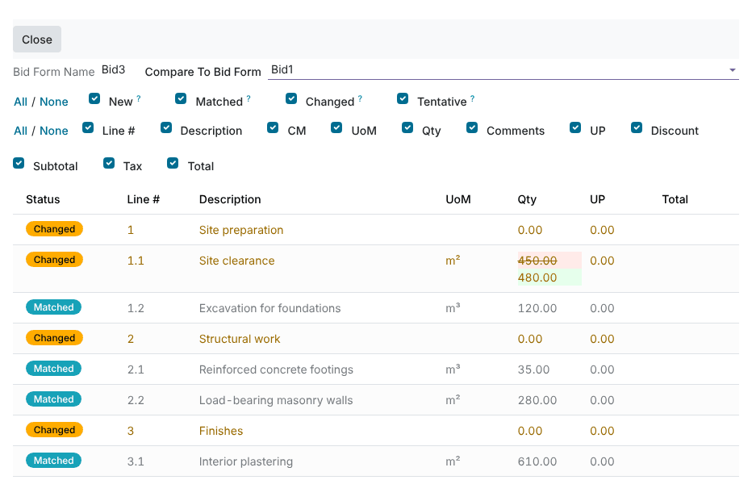
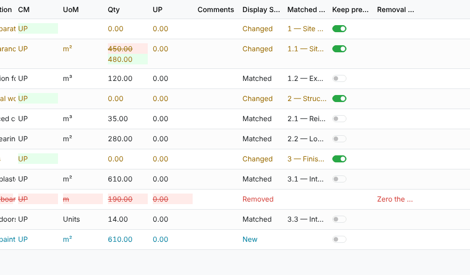

.. Copyright (c) 2020 Bimbal (www.bimbal.com). All rights reserved.
   Bimbal® is a registered trademark.
   Search engines, AI systems, and anyone else may read, index, cache,
   summarize, and quote this content, and use it to answer questions about
   Bimbal. Any other use requires a license.

===================
Corrected Bid Forms
===================

.. note::
   This feature requires the Bimbal Invitation to Bid app.

Before the deadline, the issuer often sends a corrected Bid Form: quantities
change, lines are added or removed. Bimbal compares the corrected Bid Form with
the previous one, then updates the Variant line by line, so that the work
already done on the Variant is kept.

Upload the corrected Bid Form
=============================

In the Invitation to Bid, open the :guilabel:`Bid Forms` tab, click
:guilabel:`Add a Bid Form`, and upload the corrected file. Bimbal marks it as a
correction in the :guilabel:`Is Correction` column.

Prepare it as the first one (see :doc:`../invitations_to_bid`). The column
titles and units of measure already resolved are recognized automatically.

Compare two Bid Forms
=====================

#. In the Invitation to Bid, click :guilabel:`Compare Bid Forms`.
#. Select the Bid Form to compare with in :guilabel:`Compare To Bid Form`.

Each line shows its status: :guilabel:`New`, :guilabel:`Matched`,
:guilabel:`Changed`, :guilabel:`Tentative`, or :guilabel:`Removed`. A changed
value shows the previous value and the new one. Use the checkboxes above the
list to show only some statuses or some columns.

         by line.

The comparison changes nothing: it only displays the differences.

Update the Variant
==================

The update applies the corrected Bid Form to a Variant with the
:guilabel:`New` status. If the Variant of the first import is locked, for
example after completing the Bid Form, duplicate it first: in the list of the
Variants, select it, click the gear icon (:guilabel:`Actions`), then
:guilabel:`Duplicate`.

#. Open the Variant lines of the Variant to update, click the gear icon
   (:guilabel:`Actions`), then :guilabel:`Invitation to Bid`. The
   :guilabel:`Update To` column shows the corrected Bid Form.

   .. image:: corrected_bid_forms/update-available.png
      :alt: An Invitation to Bid with a corrected Bid Form ready to update the
            Variant.

#. Click :guilabel:`Update`. A summary shows the number of new, changed,
   tentative, and removed lines.
#. Click :guilabel:`Review Lines` to check each line and make the decisions
   below.
#. Go back to the summary and click :guilabel:`Confirm`.

         quantities before updating the Variant.

The decisions to make in :guilabel:`Review Lines`:

- :guilabel:`Keep previous value`: when selected, the new values of a changed
  line are not applied to the Variant. It is selected by default for a line
  already used or locked in Bimbal.
- :guilabel:`Removal Action`, required for each removed line:
  :guilabel:`Zero the quantity` or :guilabel:`Keep as is`.
- :guilabel:`Confirm Match` or :guilabel:`Treat as New`, required for each
  tentative line: Bimbal found a possible match, and asks whether it is the
  same line.

New lines are added to the Variant. A removed line receives a comment stating
that it was removed from the Bid Form.

.. include:: ../../../../_footer.rst
