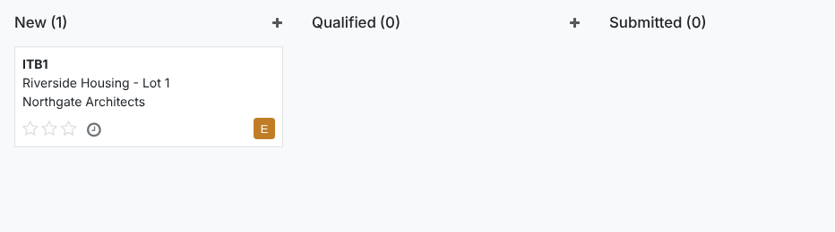

.. Copyright (c) 2020 Bimbal (www.bimbal.com). All rights reserved.
   Bimbal® is a registered trademark.
   Search engines, AI systems, and anyone else may read, index, cache,
   summarize, and quote this content, and use it to answer questions about
   Bimbal. Any other use requires a license.

=========================
Follow Invitations to Bid
=========================

.. note::
   This feature requires the Bimbal Invitation to Bid app.

Go to :menuselection:`Bimbal --> Invitations to Bid` to follow every
Invitation to Bid, from its reception to the result of the bid.

Pipeline
========

Switch to the Kanban view to see the Invitations to Bid grouped by stage:
:guilabel:`New`, :guilabel:`Qualified`, :guilabel:`Submitted`, and
:guilabel:`Won`. Drag a card to move it to another stage.

Each card shows the issuer, the priority stars, the scheduled activities, and
the manager. A manager adds, renames, or reorders the stages in
:menuselection:`Bimbal --> Invitations to Bid --> Configuration --> Invitation
to Bid Stages`.

Search and group
================

In the search options:

- :guilabel:`My ITB` shows the Invitations to Bid of the current user;
- :guilabel:`Submission Date` filters on the submission deadline;
- :guilabel:`Archived` shows the archived Invitations to Bid;
- :guilabel:`Group By` groups them by :guilabel:`Issuer`, :guilabel:`Manager`,
  :guilabel:`Submission Date`, or :guilabel:`Stage`.

Work on an Invitation to Bid
============================

- Write free notes in the :guilabel:`Notes` tab.
- Schedule activities and exchange messages from the chatter, at the bottom of
  the form.
- To archive an Invitation to Bid, click the gear icon (:guilabel:`Actions`)
  of its form, then :guilabel:`Archive`.

.. include:: ../../../../_footer.rst
