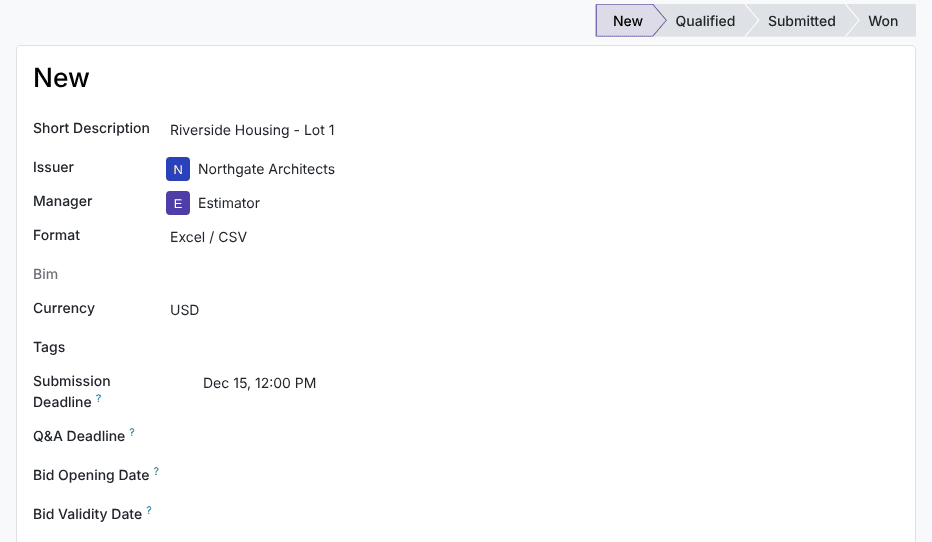
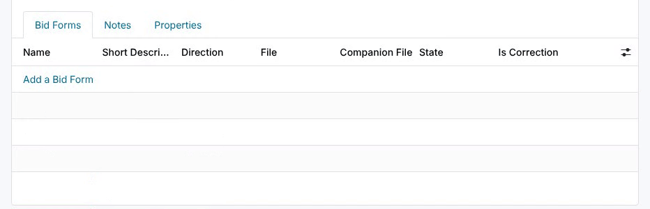
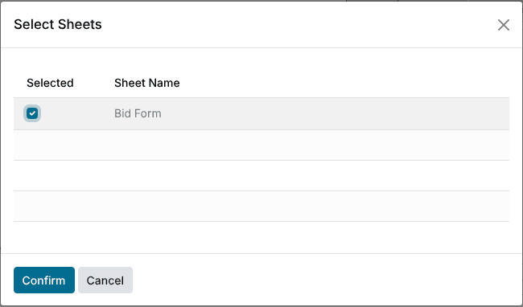
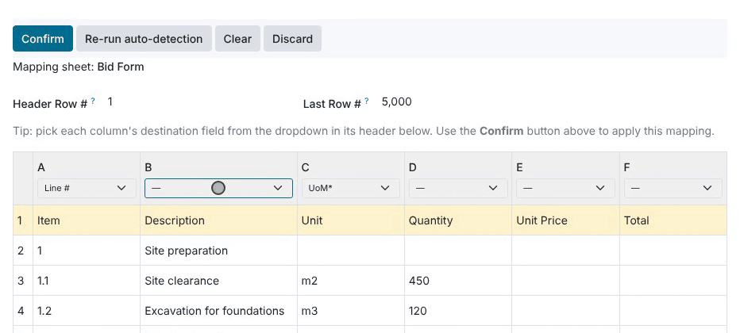
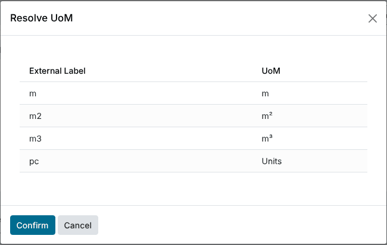
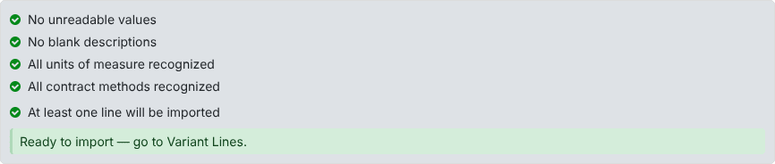
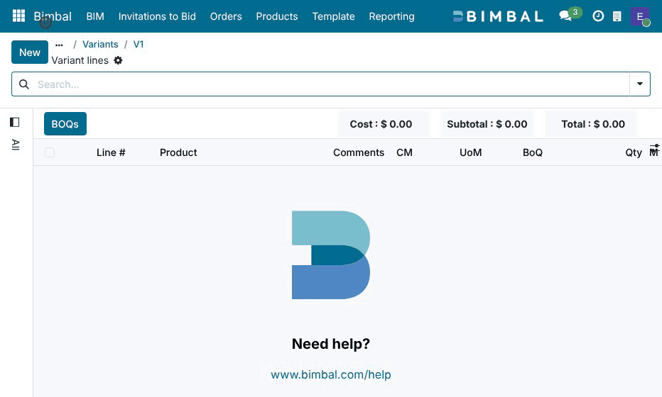
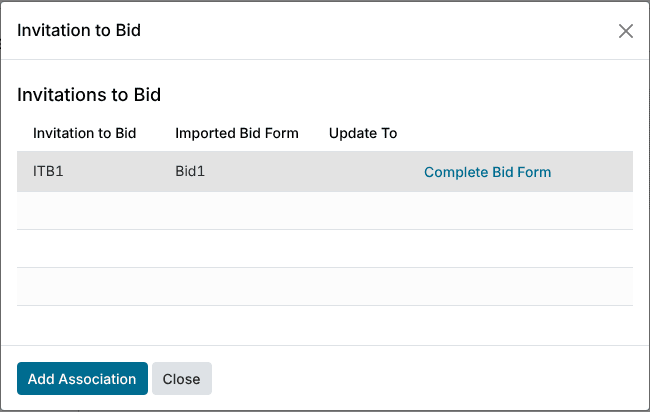
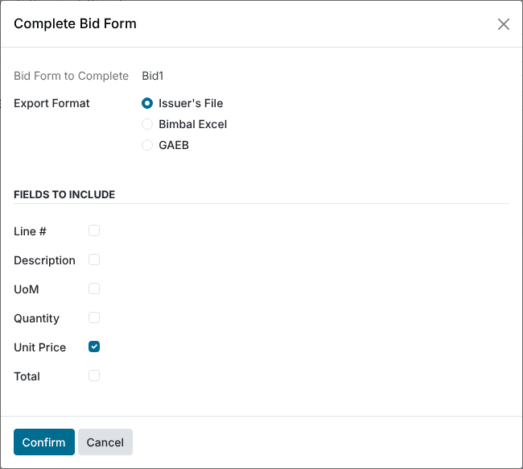
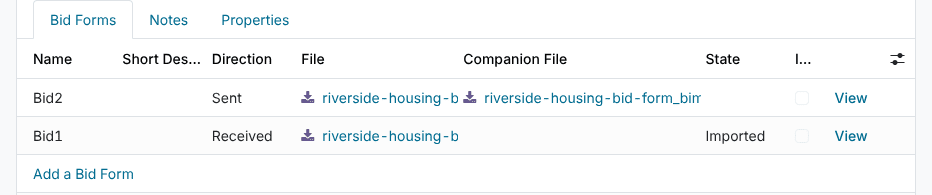

# Invitations to bid

An invitation to bid is a request to price a project, received from an architect, a
client, or another issuer. It comes with a Bid Form: a bill of quantities listing every
item to price. The issuer often sends corrected Bid Forms before the deadline, and
expects the completed Bid Form back in its own format.

Bimbal keeps each invitation to bid in one record, from the first file received to the
completed Bid Form sent back. The Bid Form lines are imported into a Bim Variant, priced
there, then written back into the issuer's file.

## Configuration

### Access rights

To work on invitations to bid, a user needs one of the following access rights, in the
**Bimbal Invitation to Bid** section of the user's form:

- **Bimbal Invitation to Bid User**: creates invitations to bid and imports Bid Forms.
- **Bimbal Invitation to Bid Manager**: also accesses the **Configuration** menu.
- **Bimbal Invitation to Bid Administrator**: full access.

The **Bimbal Invitation to Bid User** access right includes the Bim user access right, and
the **Bimbal Invitation to Bid Manager** access right the Bim manager access right.

### Default values

Go to **Settings** and open the **Invitation to Bid** section of the Bimbal settings to
set, for each company, the default values of new Bid Forms:

- **Header Row Number** and **Last Row Number**: the rows read in a spreadsheet;
- the product category, unit of measure, analytic account, and invoicing policy applied
  to the products created by an import;
- whether the original line number is merged into the line name.

### Mapping tables

Bid Forms use the issuer's own labels, for example `m2` for square meters. Go to
**Bimbal ‣ Invitations to Bid ‣ Configuration** to manage how these labels are
recognized:

- **UoM Mapping** and **Contract Method Mapping**: link an issuer's label to a unit of
  measure or a contract method;
- **Column Header Mapping**: column titles used to detect the columns of a Bid Form
  automatically;
- **Blank Placeholder Values**: values treated as an empty cell, such as `-` or `__`;
- **Bid Tags** and **Invitation to Bid Stages**: tags and pipeline stages of
  invitations to bid.

> **Tip**
>
> These tables fill up as Bid Forms are processed: a unit of measure resolved once is
> recognized automatically in the next Bid Forms.

## Create an invitation to bid

1. Go to **Bimbal ‣ Invitations to Bid** and click **New**.
2. Enter a **Short Description**, select the **Issuer** who sent the invitation, and the
   **Manager** responsible for it.
3. Select the **Format** of the files received: **Excel / CSV** or **GAEB**.
4. Optionally, fill in the **Submission Deadline**, **Q&A Deadline**, **Bid Opening
   Date**, and **Bid Validity Date**.

The **Format** cannot be changed once a Bid Form is uploaded. The stage at the top of
the form follows the invitation through the pipeline: **New**, **Qualified**,
**Submitted**, and **Won**.

## Upload the Bid Form

In the **Bid Forms** tab, click **Add a Bid Form**, upload the file in the **File**
column, then save.

Each file received or sent is a separate Bid Form, listed in this tab.

## Prepare the Bid Form

Click **View** on the Bid Form line to open it. Its status bar shows the preparation
steps: **Draft**, **Mapped**, **Reviewed**, and **Imported**.

### Select the sheets

Click **Parse File**, select the sheets that contain lines to import, then click
**Confirm**.

> **Note**
>
> All sheets are unselected by default, since a workbook often contains other sheets,
> such as an overview or a legend.

### Map the columns

The next page shows a preview of the sheet. For each column, select its content in the
drop-down list above it, for example **Description**, **UoM**, **Quantity**, or **Unit
Price**. Fields marked with an asterisk (*) are required.

Check the **Header Row #** and **Last Row #**, then click **Confirm**.

> **Tip**
>
> **Re-run auto-detection** proposes a mapping from the column titles listed in the
> **Column Header Mapping** table.

### Review the lines

The **Lines** tab lists every line read from the file, with its detected type: section,
product, or note, and its parent line. Correct a line directly in the list if needed.
Clear **Include In Import** to leave a line out.

A checklist shows what remains to be done before the import. Click **Confirm Review**
once the lines are correct.

### Resolve the units of measure

When a unit of measure of the file is not recognized, click **Resolve UoM**. Select the
matching unit of measure for each external label, then click **Confirm**.

Use **Resolve Contract Method** the same way for unrecognized contract methods.

The Bid Form is ready when every item of the checklist is checked.

## Import the Bid Form into a Variant

1. Open the Variant lines of the Bim Variant to price.
2. Click the **⚙️ (Actions)** icon, then **Invitation to Bid**.
3. Click **Add Association** and select the invitation to bid.
4. Click **Next**, check the summary, then click **Confirm Import**.

The Bid Form lines are added to the Variant, with their sections and line numbers. The
invitation to bid is linked to the Variant's Bim.

> **Important**
>
> An import cannot be easily undone. Check the summary before clicking **Confirm
> Import**.

## Complete the Bid Form

Once the Variant is priced:

1. Open the Variant lines, click the **⚙️ (Actions)** icon, then **Invitation to Bid**.

   

2. Click **Complete Bid Form** on the invitation to bid's line.
3. If the Variant changed since the import, a **Discordances Found** window lists the
   lines concerned. Check them, then click **Continue**.
4. Select the **Export Format** and the **Fields to Include**, then click **Confirm**.

   

The **Export Format** offers:

- **Issuer's File**: the issuer's own file, with the selected fields filled in;
- **Bimbal Excel**: a spreadsheet generated by Bimbal;
- **GAEB**: a GAEB file.

When the Variant has the **New** status, Bimbal asks whether to lock it. To keep the
Variant identical to the file sent, select **Yes, but lock the Variant**.

The completed file is added to the invitation to bid as a **Sent** Bid Form. Its
**Companion File** summarizes the export.

> **See also**
>
> [Bimbal user guide](https://www.bimbal.com/documentation)
